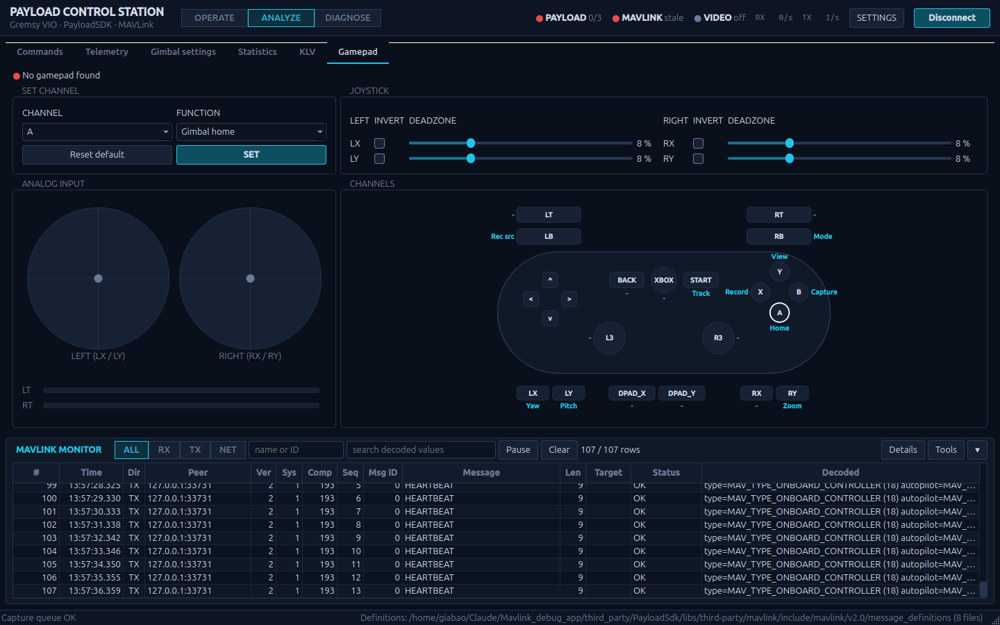
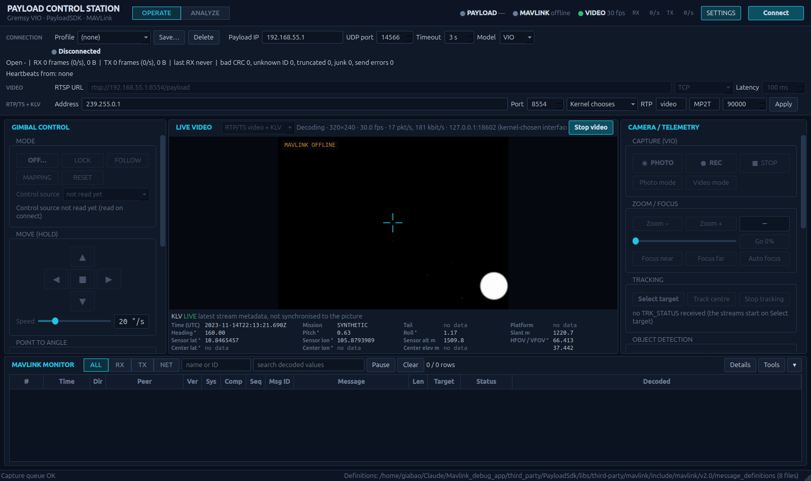
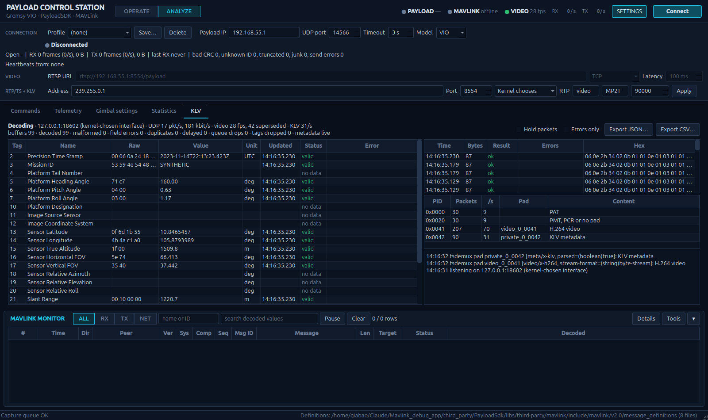

# User guide

How to use each part of the app. Build and install steps are in the [README](../README.md).

**Contents:** [Connect and main screen](#connect-and-main-screen) · [Payload control](#payload-control) ·
[Command states](#command-states) · [Payload models](#payload-models) · [Gamepad](#gamepad) · [Video](#video) ·
[MAVLink inspector](#mavlink-inspector) · [Diagnose](#diagnose)

## Connect and main screen

```bash
./build/mavlink_debug_app      # under WSLg the window opens on the Windows desktop
```

Enter the payload IP and UDP port (default `192.168.55.1:14566`) in the **SETTINGS** drawer, then click
**Connect**. Connecting never sends a movement or camera command. The drawer closes by itself once the payload's
heartbeat arrives, and reopens if connecting fails.

- **Profiles:** **Save…** stores the current IP, port, timeout and payload model under a name. Choosing
  a profile fills those fields.
- **Persistence:** profiles, the last values, inspector filters, video and gamepad settings, window size, column
  widths, the monitor's height and state, and the last view are restored on start-up. Each stored value is validated
  again before use, and invalid entries are dropped.

### Main screen

One window, built so the gimbal can be steered while watching the video:

- **Header:** status lamps, RX/TX frame rates, warnings, **SETTINGS**, and **Connect**.
  - Lamps: **PAYLOAD** (payload core 26, camera 100 and gimbal 154 with a recent HEARTBEAT, e.g. `3/3`),
    **MAVLINK** (the link state below), and **VIDEO** (player state and decoded fps).
  - Lamp colours everywhere: green = confirmed by received data, amber = partial or waiting, red = lost or failed,
    grey = off.
  - Warnings appear only for conditions observed on the link: gimbal failure flags, capture-queue drops, send
    errors, bad CRCs.
- **SETTINGS drawer:** connection profile, IP, port and timeout, the detailed link status and counters, and
  the RTSP URL, transport and latency.
- **OPERATE view:** three resizable columns. The video gets the remaining width.
  - Left, gimbal: modes, the hold-to-move pad and speed, move to angle, and the measured attitude.
  - Centre: the video, with an overlay.
  - Right: capture and recording, zoom and focus, tracking, camera settings, and camera status.
  - Side columns scroll vertically when the window is short.
- **ANALYZE view:** the command log (**Commands**), device info and the DEBUG parameter stream
  (**Telemetry**), **Gimbal settings**, traffic statistics (**Statistics**), **KLV** and **Gamepad**.
- **DIAGNOSE view:** see [Diagnose](#diagnose).
- **MAVLINK MONITOR** (below both views):
  - Always visible: direction (ALL/RX/TX/NET), message and text filters, Pause, Clear.
  - **Details** shows the decoded fields and hex dump. **Tools** holds the sys/comp/status filters, export,
    recording, and network capture.
  - **▾** collapses the monitor to one line and gives its height to the video. Capture continues.
- **Video overlay:** drawn only from validated RX frames received within the timeout. Stale values disappear
  instead of freezing.
  - REC with elapsed time, link problems, EO zoom, gimbal mode, and pitch/roll/yaw.
  - Tracking state, and the target box when the tracker reports one.
  - A centre reticle.

### Connection status

The status only reports what has actually been observed on the link:

| Status | Meaning |
|---|---|
| Socket open, nothing received | The SDK is sending heartbeats; no reply yet. This does not prove the payload is reachable. |
| Receiving data, no valid MAVLink | Datagrams are arriving, but none parsed as a valid frame. |
| MAVLink traffic, no heartbeat | Valid frames are arriving, but no HEARTBEAT within the timeout. |
| Heartbeat received | A HEARTBEAT arrived within the timeout. "Heartbeats from" lists every sysid/compid with its age. |
| Stale | Traffic was seen earlier, but nothing within the timeout. The SDK keeps sending, so the link resumes when the payload returns. |

### Screenshots

These come from the offscreen GUI test against a simulated payload (`tests/fake_payload.h`), so the values are
test data and the video is stopped. The overlay close-up uses a synthetic test picture. To regenerate them:
`SCREENSHOT_DIR=$PWD/docs/screenshots QT_QPA_PLATFORM=offscreen build/test_main_window connectedWindowShowsLiveTraffic`.
On a real payload, use the `hardwareScreenshots` run in [HARDWARE_RESULTS.md](HARDWARE_RESULTS.md).

**Operate view:** gimbal | video | camera, with the MAVLink monitor below.


**Monitor collapsed** (its height goes to the video), and the **SETTINGS drawer** open:


**Video overlay:** REC, zoom, gimbal mode, attitude, tracking state and target box, and the centre reticle.


**Analyze view:** Commands, Telemetry and Statistics.


## Payload control

The controls below are described as verified on a VIO. On other models, the panels offer only what that
model's profile supports (see [Payload models](#payload-models)). Every command goes through the PayloadSDK API.
Displayed "measured" values come only from received
frames that passed CRC validation, never from what was sent.

| Where | Controls | Feedback |
|---|---|---|
| Operate, left column | Modes OFF (with confirmation), LOCK, FOLLOW, MAPPING, RESET via the `GIMBAL_DEVICE_SET_ATTITUDE` flags; the payload's gimbal control source; move to angle (pitch ±90°, roll/yaw ±180°, the limits `setGimbalSpeed()` enforces); hold-to-move rate buttons | Measured attitude, rates, flags, failure flags and the `GB_MODE` parameter, next to the last commanded angle and the difference |
| Operate, right column | Photo/video mode, capture, start/stop recording; view source, record source and IR palette (values from the selected model's `<model>_sdk.h`); hold-to-zoom and hold-to-focus, zoom to a percentage, auto focus; object tracking (below) | `CAMERA_CAPTURE_STATUS`, `STORAGE_INFORMATION`, `CAMERA_SETTINGS`, and the values the payload reports in its DEBUG stream |
| Operate, right column | Object detection on and off; click a box to select it (nothing is sent); **Detection data…** opens a window with each packet's data | Seven states, boxes on the video, selected box's centre and size; in the window a live box table, summary, Pause and a 1000-packet log |
| Operate, right column | IR FFC auto, manual and trigger; EO one-push white balance, on models that support them | ACK in Analyze › Commands; `FFC_MODE` under *Payload reports* |
| Analyze › Telemetry | Request payload info and parameter streams; stream and FOV | Component and camera identity, app version, rangefinder, stream and FOV while fresh, and every DEBUG parameter with its age |
| Analyze › Gimbal settings | Read the gimbal's parameters; write one after a confirmation | `PARAM_VALUE` per parameter, with its age and *N of M received* |
| Analyze › Commands | — | Every action: outgoing frame, target, state, ACK result, queue and ACK latency. Double-click a frame number to open it in the inspector. |

### Notes

- **Gimbal modes:** set with the mode bits in `GIMBAL_DEVICE_SET_ATTITUDE` flags (`PayloadLink::gimbalMode()`),
  Gremsy's route since payload software v307.54 (`examples/gimbal_set_mode.cpp`). The message has no ACK:
  the button of the mode the gimbal reports is lit.
  - VIO software 3.1.8.21 rejects the older `PARAM_EXT_SET GB_MODE` and no longer lists it in its camera
    definition. Software 3.1.4.18 accepted only that older route, so it can no longer change modes from
    this app; update the payload.
  - **Control source:** the VIO passes this app's gimbal commands (modes, rates) to the gimbal only while
    `GB_FW_FLAG` is *Onboard computer* (1); with *Autopilot* (0) it drops them. The gimbal panel shows the
    value the payload reports and switches it. It is a stored payload setting, never changed by the app on
    its own; a red hint appears whenever it is not Onboard computer.
  - Bit `0x4000` of the reported flags is Gremsy's "mapping" bit; it is not defined in the MAVLink
    XML.
- **Hold-to-move rates and continuous zoom/focus:** rates are re-sent every 100 ms while a button is
  held, like Gremsy's `ui_demo`, and a zero rate is sent on release. The **Speed** slider (1–90°/s) also
  changes a held move. Zoom and focus send a
  start command on press and a stop on release. Rate repeats stop if the link closes.
- **Focus direction:** the buttons use MAVLink semantics (−1 = near, +1 = far). The SDK's
  `Camera_Focus_Value` enum names these the other way round.
- **Object tracking** (as in the SDK's `payload_do_object_tracking` example; verified on a VIO):
  - **Select target** sends three commands:
    1. `PARAM_EXT_SET TRACK_MODE` = object tracking (from `vio_sdk.h`).
    2. Starts the `TRK_*` DEBUG streams at 100 ms.
    3. `MAV_CMD_USER_4` (param1 4, param3 0) with mode ACTIVE.
  - **Then:** clicking an object on the video, or **Track centre**, sends a gimbal rate of 0, ACTIVE again,
    and the target position (param3 1, a 128×128 box). **Stop tracking** sends mode STOP.
  - **Why the rate 0:** a VIO keeps holding the last `GIMBAL_DEVICE_SET_ATTITUDE` angle (for example after
    **Move to angle**) and then tracks without moving the gimbal. A rate-0 command first, as Gremsy's
    `demo_project` sends, hands the gimbal to the tracker.
  - **Safety:** a target is never sent unless tracking is on. The SDK notes that a position sent to an
    inactive tracker still moves the gimbal ("EagleEyes").
  - **Status:** `TRK_STATUS` is decoded as `(mode << 8) | status` (IDLE / TRACKED / LOST). The target box comes
    from `TRK_POS_X/Y/W/H`, where X/Y is the box's **top-left** corner.
  - **Pixel space:** 1920×1080 for the target and the box, confirmed against the box the camera's own OSD
    draws in the 1280×720 stream.
- **Camera settings panel** (**⚙ All camera settings…** in the camera column opens and closes it): a pane under the
  video, which stays visible and playing. It takes the MAVLink monitor's place until closed; capture keeps running. Exposure, image, focus and
  zoom, thermal, video/OSD/rangefinder, 30 settings from `vio_sdk.h`. Opening it reads every setting
  (`PARAM_EXT_REQUEST_LIST`); the controls show what the camera reports. A change is sent at once and read
  back (`PARAM_EXT_REQUEST_READ`), because the VIO's `PARAM_EXT_ACK` carries no value. A number is only
  sent with **Set** once the camera has reported it. Gain and bright use the IDs the camera lists
  (`C_V_GAIN`, `C_V_BrP`): it rejects the header's `_HS` / `_LS` names.
- **Boot splash:** about 2.6 s on start-up with the startup checks (dictionary, PayloadSDK version, profile,
  target); a click or any key skips it.
- **Settings drop-downs:** a value is sent only when you pick it; refreshing the page never sends
  anything. The values the payload reports are shown separately on the status side.
- **Controls when disconnected:** all controls are disabled while the link is not open. Nothing is
  sent on application start-up.
- **Automatic info request:** once per connection, when the payload core's heartbeat (compid 26)
  first arrives, the app requests the info messages and starts the DEBUG parameter streams at
  Gremsy's `ui_demo` rates. These are read requests only, listed on the Commands tab with an
  `Auto:` prefix.

## Command states

| State | Meaning |
|---|---|
| Queued in SDK | The SDK API was called; the frame has not been seen on the wire yet. |
| Not seen on wire | Nothing matching left within 3 s. |
| Send failed | The frame was seen, but `sendto()` failed. |
| Sent, awaiting ACK | Waiting for `COMMAND_ACK` (matched by MAV_CMD and answering component) or `PARAM_EXT_ACK` (matched by `param_id`). |
| Accepted / In progress / Rejected | The ACK result (`MAV_RESULT` / `PARAM_ACK`). |
| Sent (no ACK defined) | `GIMBAL_DEVICE_SET_ATTITUDE` has no acknowledgement; check the gimbal telemetry instead. |
| No ACK (timeout) | Nothing within 3 s. This does **not** mean the command failed. |

## Payload models

PayloadSDK ships one parameter header per model (`libs/payload-define/<model>_sdk.h`). Every model it
defines has a profile here: VIO, ZIO, MB1 and OrusL. Lynx and GHadron use the MB1 profile, since the SDK builds them
with `-DMB1`. "Orus" means the OrusL profile; the SDK has no other Orus header. The full inventory and coverage matrix
are in [SDK_FEATURE_MATRIX.md](SDK_FEATURE_MATRIX.md). Choose the model with **Model** in the SETTINGS drawer. The choice is saved with each
connection profile, and changing it rebuilds the gimbal and camera panels. A header warning appears when
the payload reports a different model name.

The connection is the same for every model: MAVLink over UDP to the payload's IP and port (default
`192.168.55.1:14566`), with video at `rtsp://<IP>:8554/payload`. The controls that use only standard
MAVLink are common to all models: gimbal modes, rate and move to angle, zoom and focus, photo and
recording. What changes per model is listed below, using only that model's header:

| | VIO | ZIO | MB1 | OrusL |
|---|---|---|---|---|
| Hardware-tested | ✅ (software 3.1.4.18 and 3.1.8.21) | — | — | — |
| View source | EO, IR, EO/IR, IR/EO, Sync, Side by side | EO only | EO, IR, EO/IR, IR/EO | EO, IR, EO/IR, IR/EO, Sync, Side by side |
| Record source | ✅ | not supported | ✅ | ✅ |
| IR palette | ✅ | not supported (EO only) | ✅ | ✅ |
| Object tracking | ✅ (verified) | ✅ | ✅ | ✅ |
| Focus | ✅ | ✅ | not supported | ✅ |
| Gimbal control source | `GB_FW_FLAG` Autopilot / Onboard computer / SBUS Convert | same | same | same |
| Camera settings dialog | 30: exposure, image, focus/zoom, thermal, video/OSD/LRF | 25: exposure, image, focus/zoom, video/OSD | 60: exposure, image, focus/zoom, thermal, isotherm regions, video/OSD/AI | 38: exposure, image, focus/zoom, thermal, video/OSD/LRF |

A control the model does not support is shown disabled as "not supported by <model>". Tracking is replaced
by a note, and the control-source switch is hidden. Settings whose header gives no values, or only signed
values, are left out. Examples are OrusL gain, the MB1 `C_G_*` aliases, zoom/focus speed, LRF, AE
compensation and isotherm temperatures. Each `src/payload_profile_<model>.cpp` lists them in a comment.

## Gamepad

A USB gamepad drives the Operate controls while the link is open. It was written for and run with an Xbox Series X pad.
Plug it in at any time; the status bar shows its name. **Analyze › Gamepad** is the configuration page from Gremsy's
"Configuration Page - Gamepad control" document (Payload Plus 1.2.3), with the same panels, functions, defaults and rules:

- **Channels:** A, B, X, Y, LB, RB, BACK, START, XBOX (the guide button; Linux only, XInput does not report it), L3, R3,
  LX, LY, RX, RY, LT, RT, DPAD_X, DPAD_Y.
- **SET CHANNEL:** pick a channel (from the list or by clicking it in CHANNELS), pick a function, press **SET**. One
  function, one channel: a function already elsewhere moves, and that channel becomes None. Buttons are not offered the
  continuous functions. **Reset default** restores the table below, INVERT off and DEADZONE 8 %, at once.
- **JOYSTICK:** INVERT and DEADZONE (0–30 %, default 8 %) per stick axis, applied at once.
- **ANALOG INPUT:** both sticks (deadzone applied, not inverted) and the LT / RT travel. **CHANNELS:** the pad with each
  control's function; a control lights up while pressed.
- Everything is saved in the app's settings and restored at the next start.

| Function | What the app sends |
|---|---|
| Gimbal pitch / yaw / roll | Rate; full travel = the **Speed** slider; resent every 100 ms, zero when released. The on-screen pad wins while held. |
| Zoom | Continuous zoom tele / wide past half travel, stop when released |
| Gimbal home | The RESET button |
| Gimbal mode | LOCK ↔ FOLLOW, from the mode the gimbal reports |
| Capture image / Record video | Photo; record start, or stop while the camera reports recording |
| Change view / Change record | The next view / record source after the one the payload reports (models that support it) |
| Tracking | Off: **Select target** then **Track centre**. On: **Stop tracking** |
| Zoom tele / Zoom wide | Zoom range 100 % / 0 %, as the SDK's gamepad sample does (the document says "one step") |

Default: A home, B capture, X record, Y change view, LB change record, RB gimbal mode, START tracking, LX yaw, LY pitch,
RY zoom; the rest None. A trigger or D-pad channel given a press function fires past half its travel.

- **Linux:** reads `/dev/input/event*` (any pad with `BTN_SOUTH`; run with USB `xpad`, Bluetooth untested). The desktop
  user can read it through systemd's `uaccess` rule; elsewhere, add the user to the `input` group.
- **Windows:** XInput (part of Windows; the first of the four slots in use).



## Video

The centre of the Operate view has one **video source** at a time, chosen in its title bar:

| Source | Plays | Metadata |
|---|---|---|
| **RTSP video** (default) | `rtsp://<IP>:8554/payload` | None |
| **RTP/TS video + KLV** | H.264 from an RTP/MPEG-TS stream, default `239.255.0.1:8554` | KLV from the same stream |

**Which of these a payload sends depends on its firmware.** One capture exists: ViO beta firmware on 2026-10-29 sent
video and KLV in one TS on `239.255.0.1:8554`. Nothing has been run against a payload from this app in RTP/TS mode.
Stop the stream to change source. Only the selected source runs, so a stream is never decoded twice.

See [KLV_STREAM.md](KLV_STREAM.md) for the RTP/TS settings, the KLV tags and what they do not claim.

### RTP/TS video + KLV

- **Settings:** address, port, interface and RTP caps are in the SETTINGS drawer. **Apply** checks and saves them, and
  restarts the stream if it is running. They are separate from the connection profiles.
- **Status** in the title bar: stopped, waiting for data, receiving, decoding, decoding with no KLV in the stream, KLV only with
  no video, error (restarting), or failed.
- **KLV panel** under the video: the latest value of each main tag. A value that never arrived shows `no data`, an invalid one
  `invalid`, and an old one its age. **This is the latest metadata in the stream. It is not matched to any frame.**
- **Analyze › KLV:** every tag with raw bytes and validity, the last 30 packets, PIDs and pads, counters, the log, and JSON and
  CSV export.
- **MAVLink telemetry is separate.** The attitude drawn on the picture comes from MAVLink, the KLV panel from the stream.





### RTSP video

**Start video** is in the title bar. The URL, transport and latency are in the SETTINGS drawer:

- **URL:** built from the payload IP using Gremsy's format, `rtsp://<IP>:8554/payload`, until you
  edit it.
- **Independent of MAVLink:** it has its own Start/Stop and does not need the MAVLink connection,
  or affect it.
- **Pipeline:** `rtspsrc ! decodebin ! videoconvert ! appsink`. The URL is set as an element
  property, never parsed as pipeline syntax.
- **Threading:** frames are copied on GStreamer's streaming thread; the GUI paints only the latest
  one. Errors and end-of-stream are shown as text.
- **Transport:**
  - **TCP** (default): works through WSL2 NAT.
  - **UDP**: RTP from the VIO does not get through WSL2 NAT ("no protocols left"). Use it on native
    Linux.
  - **UDP, then TCP**: tries UDP first.
- **Measured on the VIO:** H.264, 1280×720, about 31 fps decoded over TCP while the MAVLink link
  ran at about 90 frames/s, with no errors on either.

## MAVLink inspector

The inspector shows every frame this app sends and receives on the SDK's link, from every system
and component ID, in observation order.

- **Table columns:** time, direction, peer endpoint, MAVLink version, sysid, compid, seq, message ID
  and name, length, target system/component, status, and the decoded summary (hover a cell for the
  full text).
- **Statuses:**
  - `OK` – CRC verified against the message's CRC_EXTRA.
  - `BAD_CRC` – known message ID, but the checksum does not match.
  - `UNKNOWN_ID` – message ID not in the ardupilotmega dialect, so the CRC cannot be verified.
  - `TRUNCATED` – the datagram ended before the frame did.
  - `GARBAGE` – bytes outside any frame.
  - Extra markers: `signed (unverified)` and `SEND FAILED: <reason>`.
- **Details pane:** validation result; decoded fields with type, units and enum or bitmask names
  (values equal to a field's "invalid" marker, such as NaN, are flagged); the header, including
  incompat/compat flags and the component name; and an annotated hex dump showing the header,
  payload, CRC and signature byte ranges.
- **Filters** (saved between runs):
  - direction
  - system and component ID
  - message (a number matches the ID exactly; text matches part of the name)
  - free text in the decoded values
  - status (valid only / problems / unknown ID)
- **Pause display** freezes the table only. Capture, statistics and recording continue; held frames
  are appended on resume.
- **Statistics tab:**
  - count, rate, bytes and last-seen time for each direction, sysid, compid and message
  - RX sequence gaps per sender, reported as *possible* loss (see below)

### Network capture (other devices' traffic)

The capture bar in the inspector adds MAVLink that is **not** this app's own link, for example
payload ↔ autopilot.

- **Live** on an interface, with a BPF filter. **Open .pcap…** loads a file, for example from
  `tcpdump -w drone.pcap` on a companion computer.
- **Display:** frames are tagged **NET**, with `source → destination` endpoints and the packet
  timestamps. They use the same table, details, filters, statistics, and export as the app's own
  link.
- **Isolation:** NET frames never feed the link status, telemetry, or command tracking. RX sequence
  statistics ignore them.
- **Supported packets:** IPv4/UDP over Ethernet (including VLAN), Linux "any" (SLL/SLL2), and raw
  IP. Fragments and non-UDP packets are counted as skipped.
- **Default filter:** `udp or (vlan and udp)`. Plain `udp` silently misses VLAN-tagged packets.
- **Permissions:** live capture needs root or the capability on the binary:
  `sudo setcap cap_net_raw,cap_net_admin=eip build/mavlink_debug_app`. Reading a file needs neither.
- **Visibility:** you only see traffic that reaches this interface. Other devices' unicast needs a
  hub, switch port mirroring, or capturing on one of the endpoints. Under WSL2 NAT the WSL
  interface sees only WSL's own traffic, so use native Linux for live capture.
- **Duplicates:** capturing on the interface used by the app's own link shows that traffic twice,
  once as RX/TX and once as NET. Filter by direction to separate them.

### Export and recording

- **Export visible…** writes the rows that pass the current filter. **Record…** writes every
  captured frame, unfiltered, until stopped.
- Both run on a background thread. If the disk cannot keep up, frames are dropped and the count is
  shown; write errors stop the recording with a message.

| Format | Contents |
|---|---|
| `.tlog` | Standard MAVLink telemetry log: an 8-byte big-endian UTC µs timestamp, then the raw frame. Opens in pymavlink, MAVExplorer, and Mission Planner. Contains only frames with a complete header and records no direction. Verified with `tools/check_tlog.py`. |
| `.csv` | One row per frame: index, datagram, UTC time, monotonic ns, direction, peer, header fields, target, status, signed flag, send errno, decoded summary, raw hex. |
| `.jsonl` | One JSON object per frame, with the same metadata plus typed `fields` (NaN and Inf are written as the strings `"nan"`, `"inf"`, `"-inf"`). |

## Diagnose

The **DIAGNOSE** view has two tabs.

**Health check** refreshes every second from what the link has already received; it sends nothing:

| Area | Checks |
|---|---|
| Link | Connection state, with the likely cause when nothing or no valid MAVLink arrives |
| Components | A fresh HEARTBEAT from the payload core, camera and gimbal, and each one's `MAV_STATE` (CRITICAL/EMERGENCY fail) |
| Gimbal | `failure_flags` decoded by name (e.g. `MOTOR_ERROR`), and the mode |
| Payload | Reported model against the selected one; software version if reported |
| Streams | Whether the payload's DEBUG values still update (they stop after a reboot until requested again) |
| Data | Bad CRC, truncated and garbage bytes, send errors, app capture drops, sequence gaps |
| Commands | Commands that were rejected, not answered or not sent |

Buttons:
- **Run network check** (read-only): which of this PC's adapters are on the payload's subnet (none, or several,
  is the usual cause of "connected but nothing arrives"); TCP 8000 (web app), 8554 (RTSP) and 22 (SSH); and the
  payload's software list from its web app (`/system-info`, `/update-ota`).
- **Check SDK update:** asks GitHub whether `payloadsdk_v3` has commits this build does not include. Updating means a
  new app build.
- **Export report…:** saves every row with the date, app, PC, payload and link state as a text file for a support case.

**Web settings** shows the payload's own web app (`http://<ip>:8000/`): settings, files, firmware update. It runs with no
saved cookies or cache, and asks where to save downloads. Its links act on the payload (for example, file delete
links are plain GETs). Builds without Qt WebEngine show **Open in browser** instead.
